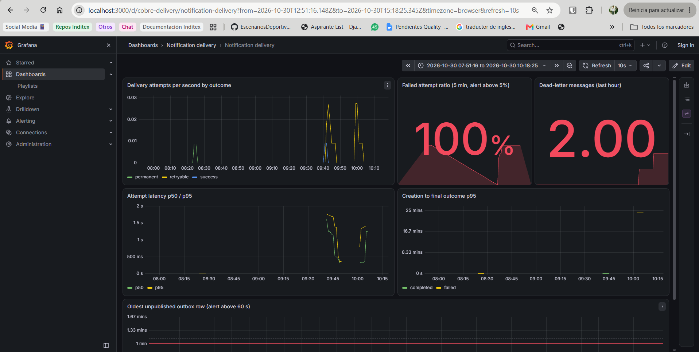

# cobre-webhook-notifications

Web project based on hexagonal architecture, packaged by capability, for delivering Cobre platform events to client webhooks over HTTPS. It uses Spring Boot and Gradle, PostgreSQL as the source of truth, Kafka as the transport and Grafana LGTM for observability. Built for the Cobre technical challenge.

> **Status:** the ten planned changes are merged into `develop` and archived into `openspec/specs/`. See the [Roadmap](#roadmap).

## Business

Each platform event is matched against the client's active subscriptions and sent to their webhook over HTTPS, with retries, a dead-letter topic and the final outcome stored. Clients manage their subscriptions and query or replay their notifications through a self-service API.

- **Delivery:** transient failures are retried with backoff, permanent failures stop at once, and the last retryable attempt fails the event in the same write (D70).
- **Self-service API:** clients list their notification events (filtered by creation date and delivery status), read one with its delivery history, and replay one that has definitely failed.
- **Isolation:** a client only sees and receives its own notifications. Its identity comes from its access token, never from the request.
- **Observability:** metrics, logs and alerts for the monitoring team.

| Endpoint | Purpose | Caller |
|---|---|---|
| `GET /notification_events` | List notification events with filters and pagination | Client (`notifications:read`) |
| `GET /notification_events/{notification_event_id}` | Notification event detail with delivery attempts | Client (`notifications:read`) |
| `POST /notification_events/{notification_event_id}/replay` | Re-send a failed notification event (`202`) | Client (`notifications:replay`) |
| `POST /events` | Ingest a platform event (`202`; `409` for a repeated `event_id`) | Producer (`events:write`) |
| `POST /subscriptions` | Register a webhook subscription; the signing secret is returned once | Client (`subscriptions:write`) |
| `GET /subscriptions`, `GET /subscriptions/{subscription_id}` | List and read subscriptions | Client (`subscriptions:read`) |
| `PATCH /subscriptions/{subscription_id}` | Change `active` and `event_types` only | Client (`subscriptions:write`) |
| `DELETE /subscriptions/{subscription_id}` | Deactivate a subscription | Client (`subscriptions:write`) |

## C4 Model

The architecture is documented with the C4 model in [`docs/architecture/system-design.md`](docs/architecture/system-design.md), in Mermaid so it stays versioned with the code:

| View | Section |
|---|---|
| Context | [C4: system context](docs/architecture/system-design.md#c4-system-context) |
| Containers | [C4: containers](docs/architecture/system-design.md#c4-containers) |
| Components | [C4: components (notifications capability)](docs/architecture/system-design.md#c4-components-notifications-capability) |
| Dynamic | [C4: dynamic view, delivery with retry and dead letter](docs/architecture/system-design.md#c4-dynamic-view-delivery-with-retry-and-dead-letter) |
| Data and states | [Data model](docs/architecture/system-design.md#data-model), [Notification event states](docs/architecture/system-design.md#notification-event-states) |
| Delivery flows | [Main flows](docs/architecture/system-design.md#main-flows) |

## Project Structure

```bash
src/main/java/com/cobre/notifications/
├── events/                     ingestion and subscription matching
│   ├── domain/
│   ├── application/            use cases and ports
│   └── adapters/               REST, persistence and outbox
├── notifications/              query, replay and delivery
│   ├── domain/
│   ├── application/
│   └── adapters/               REST, Kafka, outbox relay and HTTPS sender
├── subscriptions/              webhook destinations
│   ├── domain/
│   ├── application/
│   └── adapters/
└── shared/                     security, crypto, observability and audit
```

Each capability is split into `domain` (no framework dependencies), `application` (use cases and ports) and `adapters` (REST, Kafka, persistence, HTTPS). `HexagonalArchitectureTests` fails the build if `domain` or `application` depend on Spring, JPA or an adapter.

**Delivery flow:** `POST /events` → one PostgreSQL transaction stores the event, its notifications and an outbox row → an outbox relay publishes to Kafka → a consumer sends the signed webhook → transient errors go through retry topics with backoff → the dead-letter topic after the last attempt.

PostgreSQL is the source of truth. Kafka is the transport. A replay starts a new delivery round from the database.

## Base

This project was generated with Spring Boot and Gradle.

- **Tech stack:** Java 25 · Spring Boot 4.1 · Gradle (Kotlin DSL) · PostgreSQL 18 · Apache Kafka 4 · OpenTelemetry with Grafana LGTM · JUnit 5 · Testcontainers
- **Observability:** metrics and traces are exported over OTLP to Grafana LGTM, which hosts the dashboards and the alert rules provisioned in `docker/grafana/`.

Evidence of a local run on the delivery dashboard (2026-10-30), with the dead-letter activity:



## Installation for local test

### Requirements

- JDK 25, with `JAVA_HOME` pointing to it
- Docker (used by `compose.yaml` and by Testcontainers)

### Project build

Windows:

```bash
gradlew.bat clean build
```

Linux and macOS:

```bash
./gradlew clean build
```

### Running the app

From IntelliJ or VS Code, run `NotificationServiceApplication` with the `local` profile, or from the command line:

```bash
SPRING_PROFILES_ACTIVE=local DEMO_WEBHOOK_SECRET=whsec_local_throwaway_value ./gradlew bootRun
```

The `local` profile starts PostgreSQL, Kafka and Grafana through `compose.yaml`, and it seeds sample data. The API listens on port `8081` (`SERVER_PORT` changes it).

### Local infrastructure

```bash
docker compose up -d
```

| Service | Port |
|---|---|
| PostgreSQL | dynamic (see `docker compose ps`) |
| Kafka | `9092` |
| Grafana | [http://localhost:3000](http://localhost:3000) |

The project includes Spring Boot Docker Compose support, so `./gradlew bootRun` starts these services automatically. To run the full flow against a real HTTPS receiver, follow the [local HTTPS delivery runbook](docs/process/local-https-delivery-runbook.md).

### Webhook configuration

| Variable | Required | Purpose |
|---|---|---|
| `WEBHOOK_SECRETS_KEY` | Yes, outside the `local` profile | Base64-encoded 256-bit AES key that encrypts webhook signing secrets at rest. The application does not start without it. Generate one with `openssl rand -base64 32`. |
| `DEMO_WEBHOOK_SECRET` | Yes with the `local` profile | Development-only signing secret of the sample subscriptions (`app.seed.secret`). The application refuses to start without it. |
| `WEBHOOK_ALLOWED_HOSTS` | No (empty rejects every URL) | Comma-separated hosts that subscriptions may point to. An entry starting with `.` (for example `.example.org`) also allows that domain's subdomains. Only `https` on port 443 is accepted, and every resolved address must be public. |

The `local` profile ships a development-only key; never reuse it elsewhere.

### Receiving webhooks

Every attempt is an HTTPS `POST` with these headers:

| Header | Meaning |
|---|---|
| `Cobre-Notification-Id` | Identifier of the notification event. It is the same on every attempt and in every round, including a replay. |
| `Cobre-Signature` | `t=<unix seconds>,v1=<hex>`, where `v1` is the lowercase hex HMAC-SHA256 of `t + "." + body` using the subscription secret. |

To verify a request:

1. Read `t` and `v1` from `Cobre-Signature`.
2. Reject the request if `t` is more than 5 minutes away from your clock.
3. Compute HMAC-SHA256 of `t + "." + raw body bytes` with your secret and compare it to `v1` in constant time. Use the raw bytes as received, not a re-serialized JSON.

`t` is taken at send time on every attempt, so a retry sent after a long backoff still verifies within the tolerance. The body is byte-identical on every attempt and in every round; only `t` and `v1` change.

Delivery semantics:

- Delivery is **at-least-once** while the configured attempts and recovery operations run. A webhook may reach you more than once. There is no end-to-end exactly-once guarantee.
- Deduplicate on `Cobre-Notification-Id`: process a given identifier once and answer `2xx` for repeats.
- A timeout does not prove that you did not process the request. If you processed it but answered too late, the notification event is retried with the same `Cobre-Notification-Id` and the same body.

## Tests

Automated tests run with `./gradlew test`, and the integration tests use Testcontainers. The manual checks use JWTs from the development issuer:

```bash
CLIENT_TOKEN=$(./gradlew -q devToken --args="CLIENT001 subscriptions:read subscriptions:write notifications:read notifications:replay")
PRODUCER_TOKEN=$(./gradlew -q devToken --args="PRODUCER001 events:write")
```

Register a subscription (the response includes the signing secret, returned once):

```bash
curl -s -X POST http://localhost:8081/subscriptions \
  -H "Authorization: Bearer $CLIENT_TOKEN" \
  -H "Content-Type: application/json" \
  -d '{"url": "https://hooks.example.org/cobre", "event_types": ["credit_deposit"]}'
```

Ingest an event (`202`; `409` if the `event_id` already exists):

```bash
curl -s -X POST http://localhost:8081/events \
  -H "Authorization: Bearer $PRODUCER_TOKEN" \
  -H "Content-Type: application/json" \
  -d '{"event_id": "EVT-0001", "client_id": "CLIENT001", "event_type": "credit_deposit", "content": "{\"amount\": 250}"}'
```

List failed notification events since a date (`created_from` and `created_to` take ISO-8601 instants with a zone, for example `2026-10-29T00:00:00Z`):

```bash
curl -s "http://localhost:8081/notification_events?created_from=2026-10-29T00:00:00Z&delivery_status=failed" \
  -H "Authorization: Bearer $CLIENT_TOKEN"
```

Replay a failed notification event:

```bash
curl -s -X POST http://localhost:8081/notification_events/<notification_event_id>/replay \
  -H "Authorization: Bearer $CLIENT_TOKEN"
```

The scenarios in the [demo test plan](docs/process/seed-and-demo-test-plan.md) and the [verification checklist](docs/process/demo-verification-checklist.md) cover the rest.

## How we work

The project follows a hybrid **ODD + SDD** approach (objective-driven, then specification-driven) with [OpenSpec](https://github.com/Fission-AI/OpenSpec).

1. Every change starts as an OpenSpec proposal with Given/When/Then scenarios in `openspec/changes/`.
2. A human approves the specification before any code is written.
3. Each scenario becomes an automated test.
4. Before each pull request, an independent AI reviewer audits the diff against the specification; a human decides which findings to apply.
5. After merge, the change is archived into `openspec/specs/`.

**Branching:** `main` and `develop`. Feature branches start from `develop`, one per OpenSpec change. Pull requests into `develop` are squash-merged; `develop` is merged into `main` with a merge commit.

**Commits:** [Conventional Commits](https://www.conventionalcommits.org/), for example `feat(notifications): add self-service query endpoints`.

**CI:** every pull request validates the OpenSpec changes, builds and runs the tests, and reviews new dependencies for known vulnerabilities.

```bash
openspec validate --all --strict
```

## Roadmap

| # | OpenSpec change | Status |
|---|---|---|
| 1 | `add-self-service-query` | Merged and archived |
| 2 | `add-event-ingestion-and-delivery` | Merged (#6); archived |
| 3 | `add-notification-replay` | Merged (#9); archived |
| 4 | `add-subscription-management` | Merged and archived |
| 5 | `add-observability-and-audit` | Merged (#13); archived |
| 6 | `add-subscription-limits` | Merged (#19, #29); archived |
| 7 | `add-retry-after-cap` | Merged (#30, #35, #40, #43, #53); archived |
| 8 | `add-processing-recovery` | Merged (#20); archived |
| 9 | `add-signed-delivery-rules` | Merged (tests and receiver documentation; the behaviour already existed); archived |
| 10 | `add-transient-dns-retry` | Merged (#32, #40, #45); archived |

Changes 6 to 10 come from the [reconciliation plan](docs/process/discrepancy-reconciliation-2026-10-28.md). Each one is specified in `openspec/changes/` before any code.

## Documentation

| Document | Content |
|---|---|
| [Problem statement](docs/challenge/problem_statement.md) | The challenge as provided by Cobre |
| [Challenge plan](docs/challenge/CHALLENGE_PLAN.md) | Phases, governance and capabilities |
| [Sample data](docs/challenge/notification_events.json) | Notification events used as seed data |
| [Objectives and scope](docs/requirements/objectives.md) | ODD objectives, success criteria, load assumptions and MoSCoW scope |
| [Requirements analysis](docs/requirements/analysis.md) | Sample data observations and how each ambiguity was resolved |
| [System design](docs/architecture/system-design.md) | C4 diagrams, components, data model, flows, capacity and failure modes |
| [Decision log](docs/architecture/decision-log.md) | Every design decision with alternatives, rationale and origin |
| [Security analysis](docs/security/security-analysis.md) | Threat model, OWASP API Top 10 mitigations and supply-chain findings |
| [Workflow](docs/process/workflow.md) | SDD lifecycle, branching, commits, CI and AI review |
| [Local HTTPS delivery runbook](docs/process/local-https-delivery-runbook.md) | Receiving a signed webhook over real HTTPS from a local run, with verified results |
| [Seed and demo test plan](docs/process/seed-and-demo-test-plan.md) | Test cases for seed data, delivery, failure, replay and observability |
| [Discrepancy audit](docs/process/discrepancy-audit-2026-10-28.md) | Differences found between decisions, specs and code |
| [Discrepancy reconciliation](docs/process/discrepancy-reconciliation-2026-10-28.md) | How each difference is resolved, and the pending work |
| [OpenSpec project context](openspec/project.md) | Conventions, domain vocabulary and assumptions |
| [AI usage log](docs/ai-usage/README.md) | How AI was used and validated in each phase |

## About

Web project based on hexagonal architecture for webhook notification delivery, with signed webhooks, retries and a self-service API. Built for the Cobre technical challenge.
