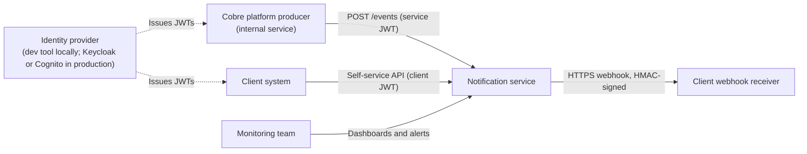
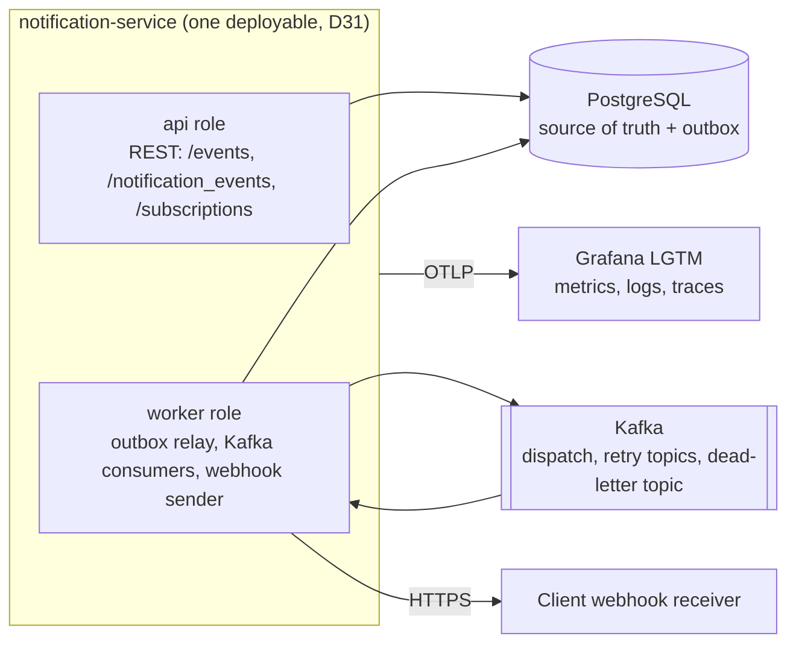
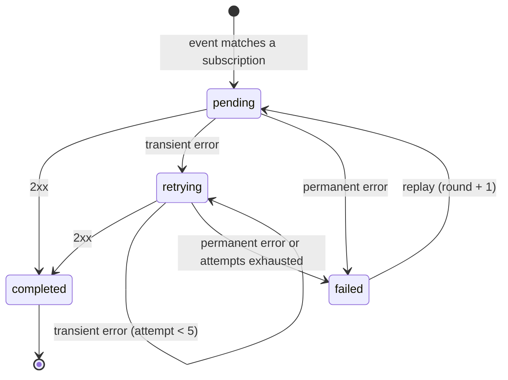
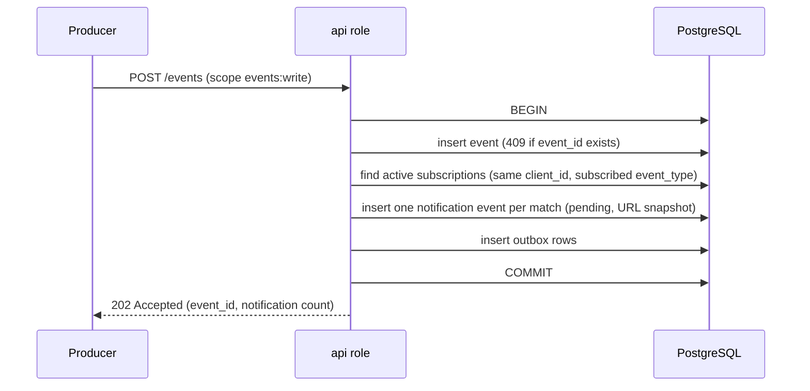
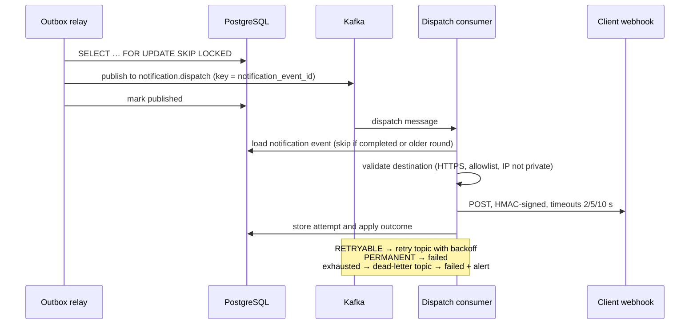

# System Design

Design for Task 1: event notification delivery and the self-service API. Decisions are referenced by ID from the [decision log](decision-log.md).

## C4: system context



## C4: containers



| Container | Responsibility |
|---|---|
| notification-service | REST API and delivery workers; `api` and `worker` roles can be deployed and scaled separately. |
| PostgreSQL | Events, subscriptions, notification events, delivery attempts, outbox. |
| Kafka | `notification.dispatch`, retry topics and the dead-letter topic. |
| Grafana LGTM | Metrics, logs, traces, dashboards and alerts. |

## Components (hexagonal, by capability)

```
events/          domain: Event, SubscriptionMatcher
                 application: IngestEventUseCase
                 adapters: in REST /events · out persistence + outbox
notifications/   domain: NotificationEvent, DeliveryAttempt, DeliveryStatus, DeliveryOutcome, RetryPolicy
                 application: ListNotificationEvents, GetNotificationEvent, ReplayNotificationEvent,
                              DispatchNotificationEvent, MarkExhausted
                 ports out: NotificationRepository, DispatchPublisher, WebhookSender,
                            SignatureService, SecretCipher, DestinationResolver, Clock
                 adapters: in REST, Kafka consumers, outbox relay scheduler, seed loader
                           out persistence, Kafka producer, HTTPS client
subscriptions/   domain: Subscription, DestinationPolicy
                 application: create, list, get, deactivate, patch
                 adapters: in REST · out persistence
shared/          security (JWT, scopes, client identity) · crypto (HMAC, AES-GCM) · observability · audit
```

The domain decides whether an error is retried (D21): `DeliveryOutcome` is `SUCCESS`, `RETRYABLE` or `PERMANENT`. The Kafka adapter only maps `RETRYABLE` to a retry topic. If Kafka is replaced (fallback plan), retry rules do not change.

## Data model

| Table | Key columns |
|---|---|
| `events` | `id`, `client_id`, `event_type`, `content`, `created_at` |
| `subscriptions` | `id`, `client_id`, `url`, `event_types[]`, `active`, `secret_ciphertext`, `created_at` |
| `notifications` | `id`, `event_id`, `subscription_id`, `client_id` (denormalized for isolation), `destination_url` (snapshot), `delivery_status`, `round`, `attempts`, `created_at`, `delivery_date`, `delivered_at`, `last_error`, `version` (optimistic locking) |
| `delivery_attempts` | `notification_id`, `round`, `attempt_number`, `http_status`, `error_type`, `latency_ms`, `attempted_at`; unique `(notification_id, round, attempt_number)` |
| `outbox` | `id`, `notification_id`, `round`, `payload`, `created_at`, `published_at` |

## Notification event states



## Main flows

### F1. Ingestion



### F2 and F3. Outbox relay and delivery



### F4. Dead-letter topic

The handler marks the notification event `failed`, sets `delivery_date`, increments a metric and logs the failure. Grafana alerts on any new dead-letter message.

### F5. Replay

1. Load the notification event by ID **and** the token's `client_id`; otherwise `404`.
2. If it is not `failed`, return `409`.
3. Conditional update on `version` (two concurrent replays cannot both win): `round + 1`, `pending`, new outbox row, in one transaction.
4. Return `202`.

### F6. Query

`GET /notification_events?created_from&created_to&delivery_status&page&size` with `client_id` taken only from the token and a page size of at most 100. `GET /notification_events/{id}` returns the detail with its attempts, or `404` if it belongs to another client.

## Capacity

Under the [load assumptions](../requirements/objectives.md#load-assumptions):

- **Deliveries:** 500 events/s × 1.2 subscriptions = about **600 deliveries/s**.
- **Concurrent deliveries (Little's law):** assuming 90% of receivers answer in 0.3 s and 10% in 5 s, the mean is 0.77 s, so 600 × 0.77 ≈ **460 deliveries in flight**.
- **Known limit:** a Kafka consumer processes each partition sequentially. At 0.77 s per message a partition handles about 1.3 deliveries/s, so about 460 partitions would be needed. **This does not scale as is.**
  - **MVP:** single-record consumption with virtual threads and about 48 partitions; enough for the demo.
  - **Evolution:** Confluent Parallel Consumer (per-key parallelism inside a partition) or a batch listener fanned out to virtual threads.
- **PostgreSQL:** about 2,500 writes/s (events, notifications, outbox, attempts); manageable on one managed instance. Evolution: outbox cleanup, monthly partitioning of `delivery_attempts`, 90-day retention (to be confirmed).

## Failure modes

| Failure | Behavior |
|---|---|
| Kafka down | `POST /events` keeps accepting events; the outbox accumulates them and the relay retries. An alert fires on outbox age. No data loss. |
| PostgreSQL down | The API returns `503`. Consumers pause with backoff; Kafka retains messages. |
| Client receiver down | Retries, then dead-letter topic, then `failed`; the client can replay. Other clients are unaffected. |
| Application crashes mid-delivery | The offset is not committed and the message is redelivered. The idempotency check avoids double recording, but **the webhook may be sent twice**; receivers deduplicate with `Cobre-Notification-Id`. |
| Relay crashes after publishing, before marking | Duplicate publish, absorbed by the idempotent consumer. |

## Sensitive data

`content` is never logged, always travels over TLS and is returned only to its owner. Encryption at rest is delegated to the database in production (for example, RDS with KMS); there is none locally.

## Scalability and evolution

- Stateless replicas; Kafka partitions and the consumer group provide parallelism; `SKIP LOCKED` allows several relays.
- Non-blocking retries isolate unhealthy receivers; strict timeouts protect worker capacity.
- Target production platform: AWS (container service, managed Kafka such as MSK or Confluent Cloud, RDS).
- Evolutions: per-destination circuit breaker, Debezium CDC for the outbox, keyset pagination, Redis-backed rate limiting, a Kafka consumer adapter for platform events, mTLS for internal producers.
